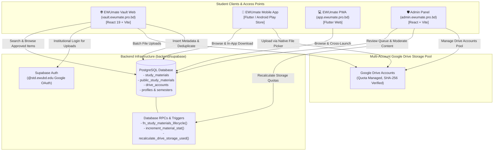

# EWUmate Vault (`vault.ewumate.pro.bd`)

[](https://react.dev/)
[](https://www.typescriptlang.org/)
[](https://vitejs.dev/)
[](https://tailwindcss.com/)
[](https://supabase.com/)
[](https://vault.ewumate.pro.bd)

> **The Public Academic Archive for East West University**  
> An open, lightning-fast study materials portal engineered to preserve and democratize past exam questions, lecture slides, lab manuals, and class notes across all academic departments.

---

## 🏛 Ecosystem Role: Part of the EWUmate Full System

**EWUmate Vault** is the standalone public web gateway within the broader **EWUmate Student Productivity Ecosystem**:



---

## 🌟 Key Features

### 1. 100% Public, Zero-Friction Access
- **No Login Required for Reading**: Students, faculty, and alumni can instantly search, browse, preview, and download thousands of academic files without creating an account.
- **In-Browser PDF Previews**: Interactive preview modal with full-screen zoom, keyboard shortcuts, and direct print/share capabilities.
- **Direct 1-Click Downloads**: High-speed downloads powered by Google Drive CDN.

### 2. Multi-Faceted Real-Time Filtering
- **Course Code Filter**: Instant filtering across all university courses (e.g., `CSE106`, `MAT101`, `PHY109`, `ENG101`, `ACT101`).
- **Semester Filter**: Organized by academic terms (`Spring`, `Summer`, `Fall` across all academic years).
- **Faculty Initial Filter**: Filter notes and questions by instructor initial (e.g., `FARHAD`, `DFK`, `JUDDIN`).
- **Category Filter**:
  - 📝 Mid Exam Questions
  - 🎓 Final Exam Questions
  - 📑 Quiz Questions
  - 📊 Lecture Slides
  - 📓 Class Notes
  - 🔬 Lab Manuals & Code
  - 🗺️ Course Outlines
  - 📚 Textbooks & References
- **Dynamic Counters**: Live count badges across all categories, courses, and faculties computed directly from approved materials.

### 3. Strict Institutional Security (@std.ewubd.edu)
- While viewing and downloading is completely open, **uploading requires an official East West University student account**.
- Google OAuth is strictly locked with `hd: 'std.ewubd.edu'`.
- Client-side and database-level email validation (`validateAllowedEmail`) instantly terminates unauthorized personal Gmail/Yahoo sessions, preventing spam and maintaining high academic standard integrity.

### 4. Storage Quota Lifecycle & Zero Ghost Files
- **Multi-Account Storage Pool**: Uploads are distributed across managed Google Drive storage accounts with real-time byte quota monitoring (`drive_accounts`).
- **Lifecycle Trigger (`fn_study_materials_lifecycle`)**: Automatically increments `used_bytes` when an upload is inserted, decrements on deletion, and recalibrates when file sizes update.
- **Zero Ghost File Uploads**: Both web and mobile clients strictly validate Drive upload responses—if a Google Drive upload fails or returns a dummy ID, the transaction is immediately aborted, preventing orphaned records in PostgreSQL.
- **Client-Side SHA-256 Deduplication**: Files are hashed prior to upload to prevent identical files from consuming duplicate storage.

### 5. Social Proof & Student Engagement
- **Local Bookmarking**: One-click bookmarking saved to `localStorage` allowing students to curate custom revision lists across study sessions.
- **Helpful Upvotes**: In-modal `👍 Helpful` voting with optimistic UI and Supabase RPC tracking (`increment_material_stat`).
- **Issue Reporting**: Students can report broken links, corrupted files, or incorrect course codes directly to the moderation queue.

### 6. Contributor Hall of Fame & Leaderboard
- Celebrates student contributors who upload materials for their peers.
- Dynamic contributor profiles displaying total contributions, department, and earned rank badges:
  - 🌟 **Pioneer**
  - 🏆 **Master Contributor**
  - 🎓 **Scholar**
  - ⭐ **Rising Star**

### 7. Cross-Platform Ecosystem Synergy
- Persistent promo banners and interactive feature modals guide web visitors to install the **EWUmate Companion Mobile App** (Live schedule tracker, class gap notification alerts, CGPA goal simulator, advising assistant) and use the **EWUmate Student Services** PDF generator.

---

## 🏗️ Technical Architecture & Design

### Responsive Layout Strategy
The Study Vault is optimized for both desktop productivity and mobile convenience:
- **Card Layout**:
  - **Header**: Category pill on left (`max-w-[calc(100%-40px)]`), bookmark button docked on top-right (`shrink-0`).
  - **Body**: File title with 2-line clamp, dedicated full-width contributor row with avatar circle, and flexible academic tags row (`Course`, `Faculty`, `Semester`, `Size`).
  - **Footer**: Symmetrical 2-column grid (`grid grid-cols-2 gap-2`) giving `[Preview]` and `[Download]` equal 50% width—preventing text clipping on narrow viewports.
- **Grid Layout**: `grid-cols-1 sm:grid-cols-2 lg:grid-cols-2 xl:grid-cols-3 2xl:grid-cols-4` with expanded `2xl:max-w-screen-2xl` width, guaranteeing `300px+` width per card on 1080p and 1440p displays.

---

## 🗄️ Database Architecture (`backend/supabase`)

The Vault relies on the following database entities:

### 1. `study_materials` (Base Table)
Stores all uploaded academic resources:
- `id` (`uuid`, Primary Key)
- `uploader_id`, `uploader_name`, `uploader_department`, `uploader_program`
- `course_code`, `course_title`, `faculty_initial`, `semester`, `file_type`
- `drive_account_id`, `drive_file_id`, `file_name`, `file_size_bytes`, `file_hash`
- `status` (`'approved' | 'pending' | 'rejected'`)
- `views_count`, `downloads_count`, `helpful_count`, `reports_count`
- `created_at` (`timestamptz`)

### 2. `public_study_materials` (Public Secure View)
Exposes approved materials to public unauthenticated users without exposing sensitive private tables:
```sql
CREATE OR REPLACE VIEW public.public_study_materials AS
SELECT 
  id, uploader_id, uploader_name, uploader_department, uploader_program,
  faculty_initial, course_code, course_title, semester, file_type,
  drive_account_id, drive_file_id, file_name, file_size_bytes, file_hash,
  created_at, status, views_count, downloads_count, helpful_count, reports_count
FROM public.study_materials
WHERE status = 'approved';
```

### 3. Stored Procedures & Triggers
- **`fn_study_materials_lifecycle()`**: Trigger on `INSERT / UPDATE / DELETE` of `study_materials` that safely updates `drive_accounts.used_bytes`.
- **`increment_material_stat(material_id, stat_type)`**: Atomically increments views, downloads, helpful votes, or reports.
- **`recalculate_drive_storage_used()`**: Admin RPC that reconciles the storage used across all active Drive accounts against approved materials.

---

## 📁 Project Structure

```
supporting_services/study_vault/
├── .github/
│   └── workflows/
│       └── deploy.yml          # Automated GitHub Pages CI/CD workflow
├── public/
│   ├── favicon.ico
│   ├── logo.png                # Brand vault logo
│   └── CNAME                   # vault.ewumate.pro.bd domain pointer
├── src/
│   ├── components/
│   │   ├── AuthModal.tsx       # @std.ewubd.edu student authentication modal
│   │   ├── ContributorProfileModal.tsx # Student contribution history & badge modal
│   │   ├── ContributorsPage.tsx# Top contributor leaderboard & rankings
│   │   ├── EWUmateModal.tsx    # Ecosystem showcase modal (Mobile App & Services)
│   │   ├── FilePreviewModal.tsx# In-browser PDF preview with Helpful & Report buttons
│   │   ├── FilterSidebar.tsx   # Desktop multi-faceted filter sidebar
│   │   ├── MaterialCard.tsx    # Symmetrical, unbreakable material card component
│   │   ├── MobileBottomNav.tsx # Mobile navigation bar
│   │   ├── MobileFilterDrawer.tsx # Mobile responsive bottom drawer filters
│   │   ├── Navbar.tsx          # Sticky glassmorphic top navigation bar
│   │   ├── PromoBanner.tsx     # Top companion app promotional bar
│   │   ├── UploadModal.tsx     # Quick upload modal with SHA-256 verification
│   │   └── UploadPage.tsx      # Full-page batch material upload studio
│   ├── lib/
│   │   └── supabase.ts         # Supabase client singleton
│   ├── types/
│   │   └── index.ts            # Type definitions, category metadata & email validators
│   ├── App.tsx                 # Main application controller, search & pagination logic
│   ├── index.css               # Tailwind CSS v4 styling & animations
│   └── main.tsx                # Application bootstrap
├── .env.example                # Example environment variables template
├── index.html                  # HTML entry point with SEO metadata
├── package.json                # Project dependencies and build scripts
├── tsconfig.json               # TypeScript configuration
└── vite.config.ts              # Vite configuration
```

---

## 🚀 Getting Started Locally

### Prerequisites
- Node.js 20+ installed
- npm or pnpm

### 1. Clone & Install Dependencies
```bash
git clone https://github.com/rxxeron/ewumate_vault.git
cd ewumate_vault
npm install
```

### 2. Configure Environment Variables
Copy `.env.example` to `.env`:
```bash
cp .env.example .env
```
Populate your Supabase URL and anonymous key:
```env
VITE_SUPABASE_URL=https://your-project.supabase.co
VITE_SUPABASE_ANON_KEY=your-anon-key-here
```

### 3. Run Development Server
```bash
npm run dev
```
Open [http://localhost:5173](http://localhost:5173) in your browser.

### 4. Build for Production
```bash
npm run build
```
Runs `tsc -b` type checking followed by Vite production bundling to the `dist/` directory.

---

## 🚢 CI/CD & Deployment

Every push to the `main` branch triggers the GitHub Actions workflow [`.github/workflows/deploy.yml`](.github/workflows/deploy.yml):
1. Checks out the code.
2. Sets up Node.js 20 with npm caching.
3. Installs dependencies and runs `npm run build`.
4. Uploads the generated `dist` artifact.
5. Deploys seamlessly to **GitHub Pages** bound to `vault.ewumate.pro.bd`.

---

## 🤝 Part of the EWUmate Open Source Initiative
- **EWUmate Canonical App**: [github.com/rxxeron/EWUmate](https://github.com/rxxeron/EWUmate)
- **EWUmate PWA**: [github.com/rxxeron/ewumatepwa](https://github.com/rxxeron/ewumatepwa)
- **EWUmate Admin Panel**: [github.com/rxxeron/ewumate-admin-panel](https://github.com/rxxeron/ewumate-admin-panel)
- **EWUmate Backend**: [github.com/rxxeron/ewumate-backend](https://github.com/rxxeron/ewumate-backend)
- **EWUmate Vault**: [github.com/rxxeron/ewumate_vault](https://github.com/rxxeron/ewumate_vault)

Designed and maintained with ❤️ for the student community of East West University.
